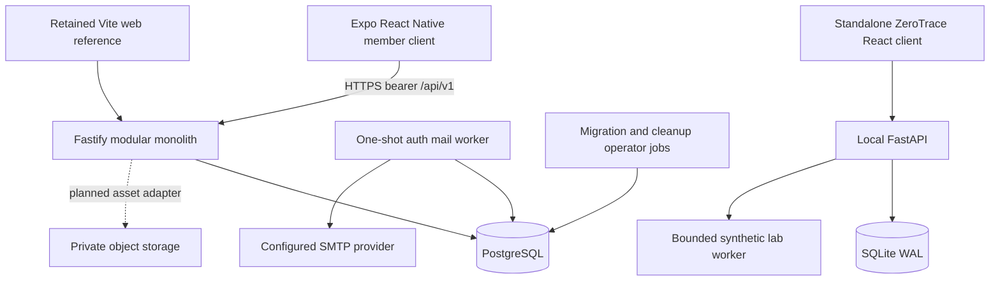

# System architecture and module inventory

Audit baseline: 21 October 2026 (Africa/Lagos). Repository: Trueda Tribe ID; standalone ZeroTrace assessed separately.

## Confirmed topology

Solid arrows are implemented connections, not proof that an environment is provisioned; SMTP provider operation is unverified. There is no deployed object-storage adapter, Redis dependency, microservice network, broker or Kubernetes requirement. No Vercel configuration was found; Vercel is not an established hosting choice.

## Repository/module ownership

| Location | Responsibility / actual implementation |
|---|---|
| `apps/mobile/index.ts`, `src/App.tsx` | Expo entry, font/environment/session composition, signed-out/status/Tribe selection/member routes |
| `src/auth`, `src/api`, `src/state` | SecureStore adapter, in-memory access tokens, serialized refresh/generation guards, deadline transport, typed clients, resource boundaries |
| `src/features/authentication` | Provisional but functional password/invitation/verification/recovery/MFA/account device forms |
| `src/features/{tribe,tribe-id,profile,announcements,events,settings}` | Native member screens; read-focused, explicit unavailable mutations |
| `apps/api/src/app.ts`, `server.ts` | Composition, shared pool, security hooks, routes, listen/close |
| `modules/auth` | Credential workflows, sessions, MFA, rate budgets, encrypted SMTP outbox |
| `modules/authentication` | Preserved interface/browser-session history; not a second public login mechanism |
| `modules/members` | Session-resolved active membership and read composition facade |
| `modules/{profiles,tribe-id,announcements,events}` | SQL readers, not complete CRUD modules |
| `modules/administration`, `notifications` | Documented future boundaries; identity authority APIs exist in auth, no full CMS/inbox |
| `infrastructure/database,security,config` | Shared counters/readiness, errors/redaction, validated process env |
| `infrastructure/{storage,cache,jobs,logging}` | README boundaries/plans; request logging is wired in app.ts, auth mail is separately implemented |
| `apps/web` | React/Vite layout/reference client, opt-in fixture preview, cookie-based requests with no Bearer header; incompatible with protected current API; not primary member release |
| `apps/mobile/qa` | Separate fixture-backed actual-component browser host; never production native entry |
| `packages/contracts` | Shared member DTOs; some auth DTOs remain local (T31) |
| `packages/database` | Plain SQL migrations, checksum runner, rollback constraint verifier, cleanup |
| `scripts`, `tests/browser` | Disposable DB/HTTP/auth/device helpers, operator CLIs, browser/native-component QA |
| `zerotrace` | Independent React/Vite + FastAPI/SQLite local research tool with own manifests/tests |

## Identity and data flow

Global users can hold multiple Tribe memberships. Login requires enabled/verified account; privileged roles require MFA. An invitation establishes a pending membership, email proof establishes mailbox control, separate authority attestation activates membership. Current status/role is resolved server-side. Bearer credentials are opaque random values, stored as hashes; 15-minute access and rotating 30-day absolute device families. Refresh locks and revokes replayed families. Access stays in memory; only refresh enters SecureStore. Unexpected rotation outcomes force fresh authentication.

Profiles/cards/teams/awards belong to membership + Tribe; readers receive server-authorized IDs. Active membership gates published content. `members/routes.ts:24` currently rebuilds the full aggregate even for focused resources; T25 reduces the resulting query fan-out without weakening authorization.

## Database inventory

Migration 001: users/tribes/memberships/profiles/cards/legacy sessions/account tokens/content/events/registrations/assets/settings/skills/teams/achievements/notifications/audit. Migration 002: device families/access+refresh tokens/shared limits. Migration 003: session cleanup indexes. Migration 004: account status/credential version, invitation/approval proof, MFA/challenges/recovery hashes/global auth events/encrypted outbox. Migration 005: identity lookup indexes. See audit database findings for constraints, lifecycle and operations limits.

## Configuration and deployment boundaries

Server env is read from process, not auto-loaded .env. Required release inputs include DB URL, independent auth encryption/rate keys, SMTP sender/transport, password blocklist, trusted proxy/network config and explicit retention. Public Expo URL/environment/optional Tribe ID are not secret stores. Production rejects development capture/preview and invalid endpoint transport. Docker defines a non-root API build, but not the complete worker/migration operational runtime. No external deployment was inspected or modified.

Evidence: [architecture decision](../../ARCHITECTURE.md), [composition](../../apps/api/src/app.ts), [mobile entry](../../apps/mobile/src/App.tsx), [migrations](../../packages/database/migrations), [Dockerfile](../../Dockerfile), [ZeroTrace app](../../zerotrace/backend/zerotrace/app.py).
